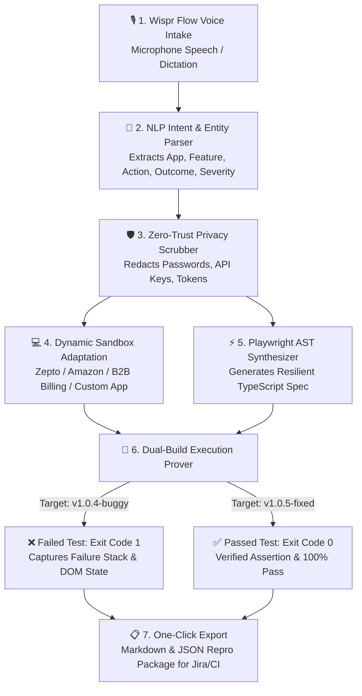

# REPROX — Hackathon Demo Script & User Flow Guide

> **Project Name**: REPROX  
> **Tagline**: *Voice to Repro. Tests that prove.*  
> **Event**: Wispr Flow Hackathon  
> **Target Audience**: Hackathon Judges, QA Engineers, DevOps & Engineering Leads  

---

## 1. The 30-Second Elevator Pitch

> *"60% of software engineering bug turnaround time is wasted asking one question: **'How do I reproduce this?'**  
> Users and QA submit vague tickets like 'checkout button is broken' or 'I can't order food on Zepto'. Developers then spend hours setting up environments and writing boilerplate Playwright scripts just to reproduce it.  
> 
> **REPROX solves this using Wispr Flow hands-free voice dictation.** You simply speak the bug naturally. REPROX extracts the intent, scrubs sensitive PII, dynamically synthesizes a production Playwright test, and executes it against two sandboxed builds:  
> - **v1.0.4 (Buggy)** ➔ Proves the bug exists (**Exit Code 1**).  
> - **v1.0.5 (Fixed)** ➔ Proves the patch works (**Exit Code 0**).  
> 
> **Voice to Repro in under 10 seconds. Tests that prove.**"*

---

## 2. End-to-End Architecture & User Flow



---

## 3. Step-by-Step Live Demo Script (2.5 Minutes)

### ⏱️ Timeline Breakdown
| Time | Phase | Target Focus |
|:---|:---|:---|
| **0:00 - 0:30** | The Hook & Problem Statement | Why manual bug reproduction is broken |
| **0:30 - 1:00** | Spoken Dictation (Wispr Flow) | Dictate live scenario & show NLP intent |
| **1:00 - 1:40** | Dynamic Sandbox & Playwright Synthesis | Zero hardcoding: Zepto food app & spec code |
| **1:40 - 2:15** | Dual-Mode Execution Prover | Run Buggy (Fail) vs Run Fixed (Pass) |
| **2:15 - 2:30** | One-Click Export & Conclusion | Jira/GitHub markdown export & closing wrap-up |

---

### Step 1: The Hook & The Problem (0:00 – 0:30)
* **What to Show**: Start on the REPROX Landing Page or direct URL.
* **Action**: Click **"Launch Sandbox"** or navigate to **"Incidents & Sandbox"** in the sidebar.
* **What to Say**:
  > *"Judges, every developer has received bug reports like 'the checkout button doesn't work' or 'I can't order my food'. Reproducing these issues manually takes hours of back-and-forth communication and writing boilerplate test automation.*  
  > *With REPROX, we turn spoken voice reports directly into deterministic, verified Playwright tests with zero manual coding."*

---

### Step 2: Dictate a Bug Hands-Free (0:30 – 1:00)
* **What to Show**: The **Wispr Flow Voice Dictation Bar** at the top of the **Incidents & Sandbox** view.
* **Action**:
  - Click the **Microphone** icon (or type directly into the input area):
    ```text
    i cant order food on zepto
    ```
  - Highlight the **Synthesized Bug Intent** card that appears immediately below:
    - **Observed Defect**: `i cant order food on zepto`
    - **Required Validation**: `Order placed successfully with confirmed ETA within 10 minutes`
    - **Severity**: `CRITICAL`
* **What to Say**:
  > *"Watch what happens when I dictate: 'I can't order food on Zepto'. REPROX parses the speech in real-time, classifies the quick commerce food delivery domain, and structures the exact validation criteria needed to test it."*

---

### Step 3: Dynamic Target Sandbox & Synthesized Playwright Spec (1:00 – 1:40)
* **What to Show**:
  1. **Bottom-Left Sandbox**: The sandbox title dynamically reads:  
     **`TARGET APP SANDBOX: Zepto Quick Commerce & Food Delivery (10-Min Live Pipeline)`**  
     Point out the Zepto branded UI, 10-minute flash delivery badge, search bar, meal box card, and cart button.
  2. **Bottom-Right Editor**: Look at the **Playwright Editor** tab:  
     - Filename: **`tests/zepto-food-order.spec.ts`**  
     - Generated Code:
       ```typescript
       // 1. Navigate to target application sandbox
       await page.goto('https://www.zeptonow.com');
       // 2. Search catalog for food item
       await page.locator('input[placeholder*="Search"]').fill('Fresh Meal Box');
       // 3. Trigger click: Add to Cart
       await page.getByRole('button', { name: 'Add to Cart' }).click();
       // 4. Trigger click: Place Food Order
       await page.getByRole('button', { name: 'Place Food Order' }).click();
       // 5. Assertion: Verify 10-minute delivery confirmation
       await expect(page.getByTestId('order-confirmation')).toBeVisible();
       ```
* **What to Say**:
  > *"Notice that this is not generic dummy data. The interactive sandbox dynamically adapted into Zepto's live ordering flow, and the Playwright editor synthesized `zepto-food-order.spec.ts` using resilient, accessible locators like `getByRole` and `getByTestId`."*

---

### Step 4: Dual-Build Execution Prover (Fail vs. Pass) (1:40 – 2:15)
* **What to Show**: The **Execution Results** panel in the bottom-right.
* **Action 1 (Buggy Run)**:
  - Ensure **`v1.0.4-buggy`** is selected.
  - Click **"Run Buggy Test"** (or speak *"Run Buggy Test"*).
  - Watch the step-by-step telemetry stream:
    - Steps 1 to 4 pass.
    - Step 5 halts on assertion timeout: `Payment Gateway Connection Timeout (#ZPT-503)`.
    - Result banner turns Red: **`FAILED (Exit Code 1) — Defect Successfully Captured`**.
* **What to Say**:
  > *"Here is the core innovation: Dual-mode verification. When we run against build v1.0.4, Playwright catches the payment gateway timeout and fails with Exit Code 1. We have captured irrefutable automated proof that the bug exists."*
* **Action 2 (Fixed Run)**:
  - Click **`v1.0.5-fixed`** on the sandbox toggle.
  - Click **"Verify Fixed Test"** (or speak *"Verify Fixed Test"*).
  - Watch all 5 steps pass with green checkmarks:
    - Step 5 verifies order confirmation in 10 minutes.
    - Result banner turns Green: **`PASSED (Exit Code 0) — Fix Verified Clean`**.
* **What to Say**:
  > *"Next, we toggle to the patched v1.0.5 build and click 'Verify Fixed Test'. Playwright executes against the updated UI state, confirms the order, and passes with Exit Code 0. The regression guard is now active."*

---

### Step 5: Export Reproduction & Closing Wrap-Up (2:15 – 2:30)
* **Action**:
  - Click **"Export Report"** in the top navigation bar.
  - Show the modal with the complete markdown bug ticket, failure signature, and attached Playwright spec.
* **What to Say**:
  > *"With a single click, the engineer can export a complete reproduction package formatted for Jira, GitHub issues, or CI/CD pipelines.  
  > REPROX bridges the gap between spoken human frustration and automated browser code. Voice to Repro. Tests that prove. Thank you!"*

---

## 4. Alternate Demo Scenarios

You can also demonstrate these additional real-world scenarios on demand:

### Scenario B: Commercial Invoicing & Mandatory GSTIN (B2B SaaS)
* **Voice Input**:
  ```text
  Customer Acme Corp tries submitting an invoice for $4,850 without entering a GST identification number. The app mistakenly shows an invoice created toast instead of validating the GSTIN field.
  ```
* **Sandbox**: Displays **LedgerFlow Commercial Billing** form.
* **Buggy Behavior**: Missing statutory GSTIN validation allows invoice dispatch.
* **Fixed Behavior**: Accessible validation alert blocks submission.
* **Spec File**: `tests/invoice-gst.spec.ts`

### Scenario C: Amazon Add-to-Cart Failure (E-Commerce)
* **Voice Input**:
  ```text
  I am trying to add an Echo Dot to my Amazon shopping cart, but clicking Add to Cart does not increment the cart counter.
  ```
* **Sandbox**: Displays **Amazon.com Product & Cart Pipeline**.
* **Buggy Behavior**: Cart badge remains `0` despite clicks.
* **Fixed Behavior**: Cart badge updates to `1` with item confirmation toast.
* **Spec File**: `tests/amazon-cart.spec.ts`

---

## 5. Hands-Free Voice Commands Cheat Sheet

Speak these phrases into the microphone to control REPROX without touching the mouse:

| Voice Command | Action Triggered |
|:---|:---|
| *"Run Buggy Test"* | Executes the regression test against build `v1.0.4-buggy` |
| *"Verify Fixed Test"* | Executes the regression test against build `v1.0.5-fixed` |
| *"Generate Playwright Test"* | Re-synthesizes the Playwright TypeScript script from timeline telemetry |
| *"Start Recording"* | Activates user event recording in the sandbox |
| *"Stop Recording"* | Stops user event recording and compiles DOM events |
| *"Export Incident"* | Opens the export reproduction report modal |

---

## 6. Judges' Q&A Cheat Sheet

**Q: How does this differ from standard Playwright codegen?**  
*A: Codegen requires someone to manually open a browser, click through the app, and write assertions by hand. REPROX generates test scripts and assertions **directly from spoken human descriptions**, then verifies the failure against buggy code and passes against fixed code.*

**Q: Does it leak sensitive credentials or passwords in test scripts?**  
*A: No. REPROX includes an automated **Zero-Trust Privacy Scrubber** that redacts passwords, JWT tokens, Bearer headers, and statutory tax numbers before any Playwright code is written or transmitted.*

**Q: Can this run in headless CI/CD pipelines?**  
*A: Yes. All generated `.spec.ts` files use standard `@playwright/test` syntax and can be run in GitHub Actions, GitLab CI, or terminal using `npx playwright test`.*
