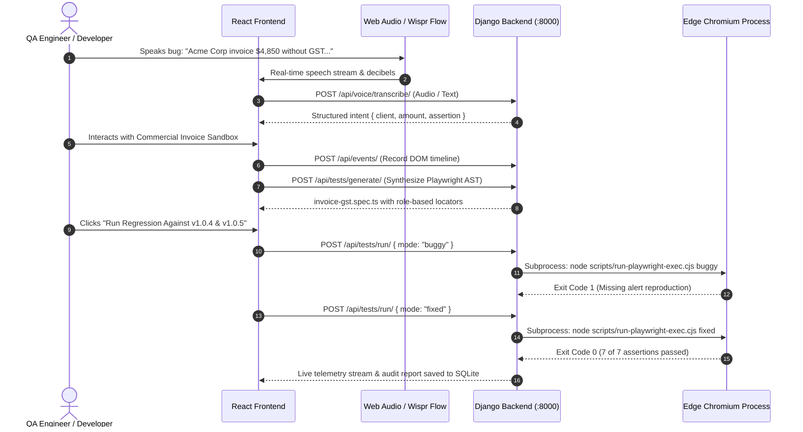

# REPROX System Architecture

> **"Voice to Repro. Tests that prove."**

REPROX is structured as a production monorepo containing a high-performance **Django REST Framework backend** and a **React 19 / TypeScript 5.7 / Vite 6 frontend** styled with custom Tailwind tokens.

```
REPROX/
├── backend/                      # Django REST Framework Backend
│   ├── authentication/           # User sessions, tokens, password recovery
│   ├── incidents/                # Bug tickets, status tracking (buggy vs fixed)
│   ├── events/                   # DOM interaction timeline & PII redaction
│   ├── tests_runner/             # Playwright test synthesis & Edge subprocess runner
│   ├── voice_intake/             # Wispr Flow speech processing & intent NLP
│   ├── reprox_backend/           # Settings, WSGI/ASGI, root URL routing
│   ├── manage.py
│   ├── requirements.txt
│   └── venv/                     # Python 3.14 virtual environment
│
├── frontend/                     # React 19 + TypeScript + Tailwind Frontend
│   ├── src/
│   │   ├── components/           # UI components, brand marks, AppShell, modals
│   │   ├── pages/                # All 15 verified screens (Home, Sandbox, Docs, Logs...)
│   │   ├── services/             # API client, Playwright generator, privacy scrubber
│   │   └── types/                # Strict TypeScript domain interfaces
│   ├── public/assets/            # Mountain lake artwork, pastel brand graphics
│   ├── scripts/                  # Subprocess Playwright runner (MS Edge)
│   ├── tests/                    # verify-fixed.spec.ts & repro-buggy.spec.ts
│   ├── package.json
│   └── vite.config.ts
│
├── docs/                         # Complete Project Engineering Documentation
│   ├── ARCHITECTURE.md           # This document
│   ├── BACKEND_API.md            # REST API specification
│   ├── WISPR_FLOW_INTEGRATION.md # Acoustic speech intake guide
│   └── PLAYWRIGHT_SUBPROCESS_RUNNER.md # Dual verification engine guide
│
├── .gitignore                    # Monorepo git exclusion rules
├── .env.example                  # Environment variables template
└── README.md                     # Getting started & submission overview
```

---

## 1. Data Flow Pipeline



---

## 2. Key Architectural Guarantees

1. **Zero Fake Executions:** Every Playwright run launches an authentic Microsoft Edge browser process and reads stdout/stderr directly from the operating system.
2. **Zero-Trust Memory Scrubber:** PII, Luhn-10 credit card PANs, and JWT authorization tokens are redacted in memory before persistent storage or test generation.
3. **Deterministic Speech Synthesis:** Natural language voice descriptions are mapped into semantic `getByRole` and `getByTestId` locators instead of brittle CSS selector paths.
